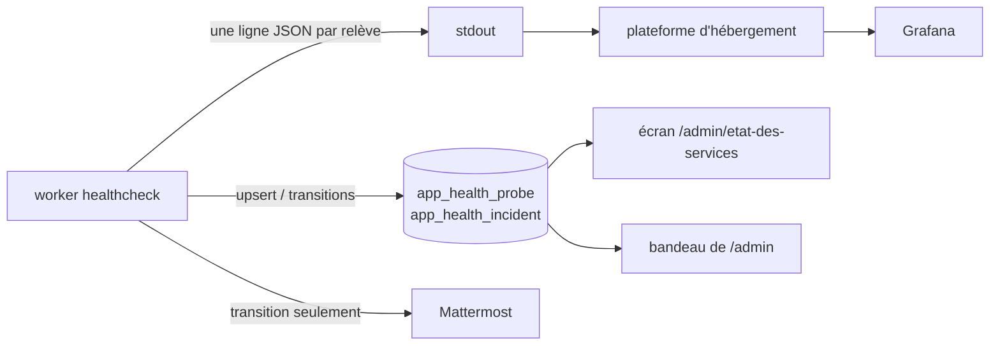

# Supervision

La supervision répond à une question : **le service marche-t-il maintenant, et qu'est-ce qui ne tourne pas ?** Elle est portée par un worker dédié, `packages/healthcheck`, qui vit dans le cluster à côté de l'application — un sondeur embarqué dans le processus Next.js mourrait avec lui et ne verrait jamais la chaîne ingress → passerelle → application.

Trois sorties, une seule source :

| Sortie | Pour qui | Ce qu'elle donne |
|---|---|---|
| Écran `/admin/etat-des-services` | équipe d'exploitation, le jour | l'état courant, les traitements en retard, les incidents des 30 derniers jours |
| Canal Mattermost | équipe d'exploitation, la nuit | une alerte par panne, un retour par rétablissement |
| Lignes `health_check` sur stdout | plateforme d'hébergement → Grafana | l'historique et les courbes ; c'est la seule matière des tableaux de bord |

Le worker écrit son état dans deux tables (`app_health_probe`, `app_health_incident`) que l'écran lit. **L'écran ne sonde rien** : ouvrir la page ne peut ni masquer une panne ni la faire disparaître. Le runbook, alerte par alerte, est dans [`runbook-supervision.md`](runbook-supervision.md).

## 1. Dispositif

Caractéristiques qui expliquent la suite :

- **Un seul pod**, `strategy: Recreate`. Deux sondeurs doubleraient les appels aux partenaires et se disputeraient les mêmes lignes.
- **Aucune trace conservée à chaque relève** : l'état courant est un `INSERT … ON CONFLICT (key) DO UPDATE`, et seules les **transitions** créent une ligne d'incident.
- **La configuration vient des mêmes sources que l'application** (configmaps `s3`, `clamav`, `valkey`, `mail`, `proconnect`, secret `api`) : une sonde teste la configuration réellement utilisée, pas une copie qui dériverait.

## 2. Carte des sondes

Une sonde est décrite par sa **cible**, sa **criticité** (`critical`, `important`, `low`), sa **cadence**, son **timeout** et le **seuil** qui la fait changer d'état. Les cadences et timeouts ci-dessous sont les valeurs par défaut du code ; les variables qui les déplacent sont en [§5](#5-configuration).

### 2.1 Services internes

| Sonde (`key`) | Cible | Criticité | Cadence | Timeout | Ce qui la fait changer d'état |
|---|---|---|---|---|---|
| `postgres-app` | `SELECT 1` sur la base applicative | critique | 60 s | 5 s | connexion, droits ou base → `unavailable` |
| `s3` | `HeadBucket` du bucket applicatif | critique | 60 s | 10 s | 401/403 → `misconfigured`, le reste → `unavailable` |
| `clamav` | `PING` sur clamd | critique | 60 s | 5 s | pas de `PONG` → `unavailable` |
| `valkey` | `PING` sur le cache | critique | 60 s | 5 s | authentification → `misconfigured`, le reste → `unavailable` |
| `smtp` | `verify()` de la connexion SMTP | important | 60 s | 10 s | authentification → `misconfigured`, le reste → `unavailable` |
| `pgboss-queue` | profondeur et âge de la file `email-notification` | important | 60 s | 5 s | plus de 100 jobs en attente **ou** le plus ancien depuis plus de 15 min → `degraded` |

### 2.2 Partenaires

Ces deux sondes ne sortent que si `HEALTHCHECK_PARTNER_PROBES_ENABLED` vaut `true` (voir [§6](#6-désactiver-les-sondes-partenaires)).

| Sonde (`key`) | Cible | Criticité | Cadence | Timeout | Ce qui la fait changer d'état |
|---|---|---|---|---|---|
| `proconnect` | `/.well-known/openid-configuration` chez ProConnect | critique | 15 min | 5 s | 5xx ou réseau → `unavailable`, 4xx ou document sans `authorization_endpoint` / `jwks_uri` → `misconfigured` |
| `weez` | recherche d'un SIREN de référence (DINUM) dans l'API Sirene | important | 15 min | 10 s | 5xx ou réseau → `unavailable`, 4xx ou réponse sans le SIREN → `misconfigured` |

### 2.3 Chaîne exposée

| Sonde (`key`) | Cible | Criticité | Cadence | Timeout | Ce qui la fait changer d'état |
|---|---|---|---|---|---|
| `ingress` | `/` de l'URL publique, puis le certificat TLS présenté | critique | 5 min | 10 s (5 s pour le certificat) | 5xx → `unavailable`, 4xx → `degraded`, certificat expiré → `unavailable`, certificat à moins de 30 j → `degraded` |
| `public-api` | `/api/public/openapi.json` via l'ingress | important | 5 min | 10 s | 5xx → `unavailable`, 4xx → `misconfigured`, réponse non JSON → `degraded` |
| `suit-gateway` | `/api/v1/healthz` de la passerelle APISIX, avec la clé du consumer de supervision | important | 5 min | 10 s | 5xx → `unavailable`, 4xx (clé refusée) → `misconfigured` |

La cadence de ces trois sondes est plus lente que celle des sondes internes : la sonde publique consomme le quota de l'API publique, compté par appelant, et les partenaires n'ont pas à recevoir un appel par minute.

### 2.4 Traitements planifiés

Un traitement qui ne démarre pas — image non tirée, script absent, planification perdue — **n'écrit aucune trace**. C'est l'absence de succès qui le signale, pas un échec.

| Sonde (`key`) | Trace lue | Horaire (UTC) | Criticité |
|---|---|---|---|
| `job-export-generate` | succès `export.generate`, corroboré par une ligne `app_export` récente | `0 2 * * *` | critique |
| `job-gip-mds-import` | succès `gip_mds.import` | `0 3 * * *` | critique |
| `job-declaration-cleanup` | succès `system.declaration_cleanup` | `0 3 * * *` | critique |
| `job-audit-cleanup` | succès `system.audit_cleanup` | `0 4 * * *` | critique |
| `job-reminder-*` (huit relances) | dernier job `completed` de la file pg-boss correspondante | lue dans `pgboss.schedule` | important |
| `job-email-notification-queue` | jobs en échec dans la fenêtre et âge du plus ancien job en attente | continu | important |

Les huit relances sont les files `reminder-deadline-daily-tick`, `reminder-cycle-opening-info`, `reminder-cse-opinion-compliance`, `reminder-cse-opinion-justify-oct`, `reminder-cse-opinion-justify-dec`, `reminder-cse-opinion-corrective`, `reminder-cse-opinion-joint-eval` et `reminder-next-cycle-handover`. Leur cron n'est **pas** recopié dans le sondeur : il est lu dans `pgboss.schedule`, que le worker de notifications enregistre au démarrage.

**Règle de fraîcheur** — la fenêtre d'un traitement est `HEALTHCHECK_JOB_STALE_HOURS` (défaut 26 h = 24 h + 2 h de marge de planification) **ou la période du cron quand elle est plus longue**. Un traitement mensuel ou annuel n'est donc pas rouge le reste de l'année. Aucun succès dans la fenêtre → `unavailable` (« en retard »), y compris pour un traitement qui n'a jamais réussi : l'absence de trace est le signal, pas une exception.

Un échec plus récent que le dernier succès n'est **pas** une panne tant qu'un succès reste dans la fenêtre : il est conservé dans le message pour que l'écran l'affiche sur sa propre ligne.

### 2.5 « Non configuré » n'est pas une panne

Une sonde dont la cible n'est pas configurée dans l'environnement répond `operational` avec le message « non configuré » : le pod de review qui n'a ni WEEZ ni SMTP ne doit pas paraître rouge. Ce qui est **vérifiable** est ce qui est configuré ; la liste des sondes effectivement armées se lit au démarrage du pod, dans les avertissements `[healthcheck] no … — probe not configured`.

## 3. Les états et les incidents

| État | Sens | Verdict de l'écran |
|---|---|---|
| `operational` | la cible répond et se comporte comme attendu | vert |
| `degraded` | elle répond, mais hors seuil (lenteur, certificat proche de l'expiration, file qui s'accumule) | orange |
| `unavailable` | elle ne répond pas ou répond en erreur | rouge |
| `misconfigured` | elle répond, mais refuse nos identifiants, notre clé ou notre certificat | orange |

Une **transition** ouvre un incident (`from_status` → `to_status`) ; un retour à `operational` ferme l'incident ouvert ; un échec qui change de forme (`unavailable` → `degraded`) ferme un incident et en ouvre un autre. Un échec qui persiste n'écrit rien de plus.

Les quatre états sont la matière des alertes Mattermost ; `unknown` n'existe pas côté worker, il est **calculé à la lecture** (voir [§4](#4-deux-horloges--relève-et-fraîcheur)).

**Quand une alerte part** : sur transition seulement, jamais sur un état stable. Une sonde `critical` ou `important` alerte au run qui atteint `HEALTHCHECK_ALERT_AFTER_FAILURES` échecs consécutifs, une seule fois par panne ; `misconfigured` alerte immédiatement ; `low` n'alerte jamais. Le retour n'est envoyé que si l'alerte était partie — la mémoire vient du compteur persisté, donc un redémarrage du worker ne ré-alerte pas. Les règles d'émission et leur justification sont détaillées dans [`packages/healthcheck/README.md`](../packages/healthcheck/README.md#mattermost-alerts) ; le runbook explique comment lire le message.

## 4. Deux horloges : relève et fraîcheur

La fraîcheur n'est pas la cadence. Un worker arrêté laisse en base un dernier état vert ; l'afficher tel quel mentirait sur le présent.

- Le worker relève à sa cadence et écrit `checked_at` et `interval_seconds`.
- L'écran compare `checked_at` à maintenant. Au-delà de `max(HEALTHCHECK_STALE_AFTER_SECONDS, 2 × interval_seconds)`, la ligne s'affiche **« Inconnu »** et non sa dernière couleur.

Le plancher (`HEALTHCHECK_STALE_AFTER_SECONDS`, défaut 300 s) couvre un cycle de worker et sa marge ; l'élargissement à deux cycles évite qu'une sonde partenaire, relevée toutes les 15 min, s'affiche « inconnu » dix minutes sur quinze. Quand **toutes** les lignes sont inconnues, la synthèse dit « La supervision ne répond plus » : c'est le cas « worker arrêté », traité dans le runbook.

## 5. Configuration

Les variables sont référencées **par nom** ; aucune valeur déployée, aucun secret, aucun hôte n'est recopié ici. Les surcharges par environnement vivent dans les configmaps et secrets scellés de `.kontinuous/env/`, jamais dans ce document.

### 5.1 Sondeur (`packages/healthcheck`)

| Variable | Défaut du code | Rôle |
|---|---|---|
| `HEALTHCHECK_INTERVAL_SECONDS` | 60 | cadence des sondes internes et des traitements |
| `HEALTHCHECK_PARTNER_INTERVAL_SECONDS` | 900 | cadence des sondes partenaires (ProConnect, WEEZ) |
| `HEALTHCHECK_EXPOSED_INTERVAL_SECONDS` | 300 | cadence des sondes de la chaîne exposée |
| `HEALTHCHECK_JOB_STALE_HOURS` | 26 | plancher de la fenêtre de fraîcheur des traitements |
| `HEALTHCHECK_QUEUE_MAX_PENDING` | 100 | profondeur de file au-delà de laquelle `pgboss-queue` est dégradée |
| `HEALTHCHECK_QUEUE_MAX_AGE_SECONDS` | 900 | âge du plus ancien job au-delà duquel la file est dégradée |
| `HEALTHCHECK_CERT_WARN_DAYS` | 30 | préavis d'expiration du certificat TLS public |
| `HEALTHCHECK_PARTNER_PROBES_ENABLED` | `false` | arme les sondes partenaires et exposées |
| `HEALTHCHECK_PUBLIC_URL` | — | hôte public sondé (ingress, API publique) et repli du lien de l'alerte |
| `HEALTHCHECK_WEEZ_REFERENCE_SIREN` | — | SIREN stable dont la réponse prouve que WEEZ répond |
| `EGAPRO_PROCONNECT_ISSUER` | — | base du document de découverte ProConnect |
| `EGAPRO_WEEZ_API_URL` | — | base de l'API Sirene |
| `HEALTHCHECK_APISIX_SUIT_URL` | — | base de la passerelle SUIT |
| `HEALTHCHECK_APISIX_SUIT_API_KEY` | — | clé du consumer de supervision (secret) |
| `DATABASE_URL` / `POSTGRES_*` | — | base applicative ; DSN reconstruit comme dans l'application |
| `NOTIFICATIONS_DATABASE_URL` / `NOTIFICATIONS_POSTGRES_*` | — | base de la file pg-boss ; repli sur la base applicative |
| `S3_*`, `CLAMAV_HOST`, `CLAMAV_PORT`, `VALKEY_URL`, `MAIL_ENABLED`, `SMTP_*` | — | cibles des sondes internes, lues dans les mêmes configmaps que l'application |

### 5.2 Canal d'alerte

| Variable | Défaut du code | Rôle |
|---|---|---|
| `HEALTHCHECK_MATTERMOST_WEBHOOK_URL` | — | webhook du canal (secret) ; absent → alertes désactivées, journalisé au démarrage |
| `HEALTHCHECK_ALERT_AFTER_FAILURES` | 3 | échecs consécutifs avant l'alerte d'une sonde `critical` ou `important` |
| `HEALTHCHECK_ADMIN_URL` | repli sur `HEALTHCHECK_PUBLIC_URL` | base du lien « Consulter l'état des services » |

### 5.3 Écran et bandeau (application)

| Variable | Défaut du code | Rôle |
|---|---|---|
| `HEALTHCHECK_STALE_AFTER_SECONDS` | 300 | plancher de fraîcheur avant d'afficher « Inconnu » |
| `EGAPRO_GRAFANA_URL` | — | cible du lien « Tableaux de bord Grafana » ; absente, le lien n'est pas affiché |

Ces deux variables arrivent par la ConfigMap `monitoring`, montée en `optional: true` : un environnement sans elle reste déployable.

## 6. Désactiver les sondes partenaires

Sur les review apps, N espaces de noms ne doivent pas multiplier les appels à ProConnect, WEEZ et à la passerelle. `HEALTHCHECK_PARTNER_PROBES_ENABLED: "false"` dans la ConfigMap `healthcheck` de l'environnement retire les cinq sondes partenaires et exposées ; les sondes internes et les traitements continuent. Le worker journalise alors `HEALTHCHECK_PARTNER_PROBES_ENABLED is false — partner and exposed probes not scheduled`.

La ConfigMap est montée en `optional: true` : **absente, le défaut du code s'applique (`false`)**, donc les sondes partenaires sont éteintes. Un environnement de production doit l'armer explicitement.

## 7. Ce que l'écran montre, ce qu'il ne montre pas

**Montre** : la synthèse (services indisponibles, services dégradés, traitements en retard), la table des sondes triée par gravité puis criticité (état, dernière relève, latence, dernier message), la table des traitements (dernier succès, dernier échec, prochaine exécution attendue), les incidents des 30 derniers jours (100 plus récents), le lien Grafana quand il est configuré, et le bandeau de la home `/admin` dès qu'un service critique est indisponible, qu'un traitement est en retard ou que la supervision s'est tue.

**Ne montre pas** : de courbes, d'historique de latence, ni de tendance. Cette matière n'existe que dans les lignes `health_check` de stdout, donc dans Grafana. L'écran est une photographie de l'instant et des transitions, pas une série temporelle — c'est un choix, pour que la base ne conserve pas un point par sonde et par minute.

Le bandeau de la home lit directement le service (`readServiceStatusBanner`), sans passer par la query tRPC auditée : visiter `/admin` n'écrit pas de ligne d'audit. La page `/admin/etat-des-services`, elle, écrit une ligne `read_sensitive` à chaque rafraîchissement (voir [`journaux-et-conservation.md` §4.1](journaux-et-conservation.md#41-journal-daudit-des-actions)).

## 8. Limites assumées

Chacune est un choix, pas un oubli. Une limite non écrite se lit comme une couverture qu'on croit acquise.

- **La V1 (`master`) n'est pas supervisée.** Le sondeur ne connaît que la V2 et ses dépendances.
- **Aucun statut de Job Kubernetes n'est lu** : le worker n'a pas de client d'API ni de RBAC, et n'en veut pas. `data-gouv-refresh-daily`, qui n'écrit aucune trace applicative, et les backfills lancés après un déploiement ne sont donc pas couverts. Les quatre CronJobs qui écrivent une ligne d'audit le sont.
- **La sonde « avis CSE » ne dépose rien chez SUIT** : `suit-gateway` vérifie la disponibilité de la route, pas un dépôt réel. Un rejet métier de SUIT ne se verrait pas ici.
- **Le rejeu des accusés (#4546) n'est suivi que si sa table existe** : pas de trace, pas de sonde.
- **Les alertes n'ont pas de fenêtre de silence** : elles partent 24 h/24. Le traitement aux heures ouvrées est une consigne de runbook, pas un réglage du worker.
- **Le certificat client SUIT (mTLS) n'est pas surveillé en expiration.** Aucune sonde ne lit ce certificat ; son expiration se manifeste indirectement par un échec des appels sortants vers SUIT, donc côté Sentry et non côté supervision. Voir l'entrée correspondante du runbook.
- **Hors dépôt** : la création du canal Mattermost, du webhook, et les tableaux de bord Grafana. Le dépôt ne fournit que le contrat (variable, format de ligne) ; voir [§9](#9-ce-qui-reste-à-faire-hors-dépôt).

## 9. Ce qui reste à faire hors dépôt

| À faire | Où | Responsable |
|---|---|---|
| Créer le canal Mattermost de supervision et son webhook, puis sceller `HEALTHCHECK_MATTERMOST_WEBHOOK_URL` dans le secret `healthcheck-alerts` de chaque environnement | Mattermost, puis `.kontinuous/env/<env>/templates/` | à nommer |
| Définir les tableaux de bord Grafana à partir des lignes `health_check` (latence, transitions, disponibilité) et renseigner `EGAPRO_GRAFANA_URL` | Grafana, puis ConfigMap `monitoring` | à nommer |
| Confirmer la durée de conservation des lignes d'incident et des lignes stdout côté plateforme | plateforme d'hébergement | à nommer |

Tant que le webhook manque, le worker démarre normalement, journalise `no HEALTHCHECK_MATTERMOST_WEBHOOK_URL — Mattermost alerts disabled` et n'envoie rien : un espace de noms sans secret reste déployable.

## Pour aller plus loin

- Runbook, alerte par alerte : [`runbook-supervision.md`](runbook-supervision.md)
- Écran, bandeau, routes admin : [`features.md` §12](features.md#12-espace-administrateur-dgt)
- Traitements planifiés et rétention d'audit : [`architecture.md` §9.6](architecture.md#96-traitements-planifiés-crons-de-maintenance-des-données)
- Journaux produits par la supervision : [`journaux-et-conservation.md` §4.14](journaux-et-conservation.md#414-supervision)
- Détail du worker : [`packages/healthcheck/README.md`](../packages/healthcheck/README.md)
